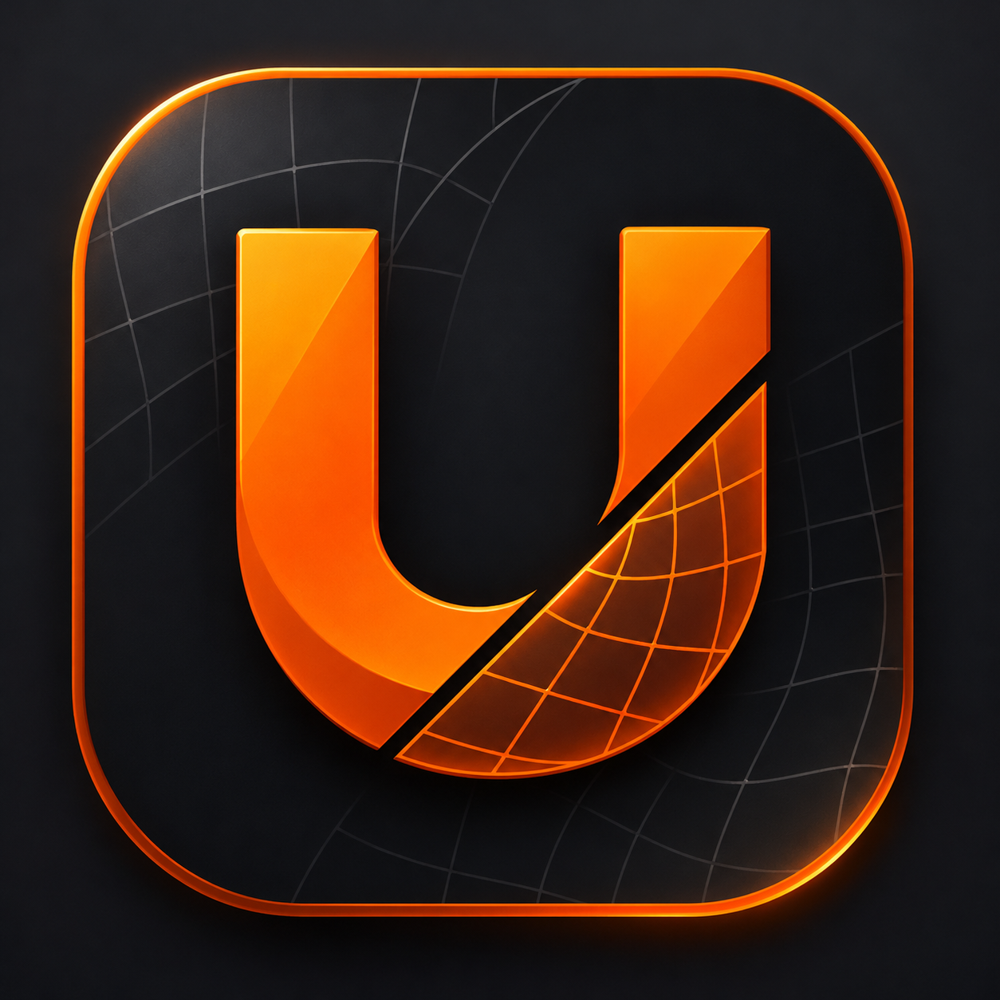
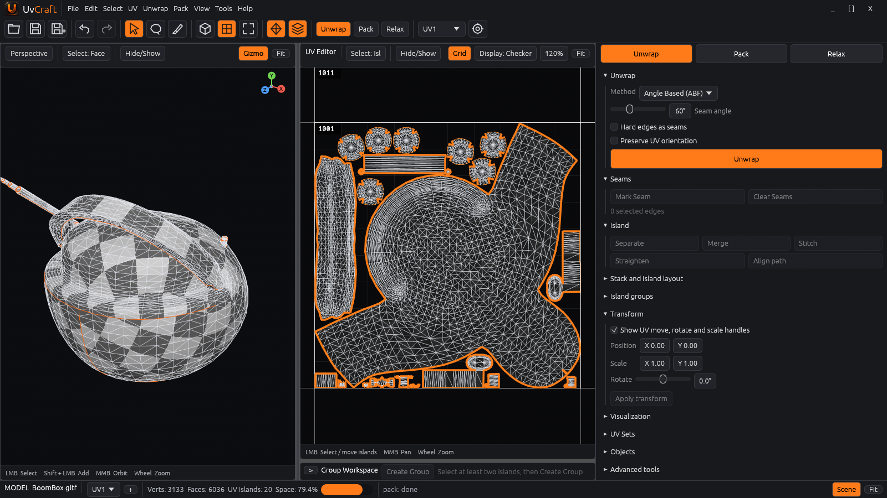
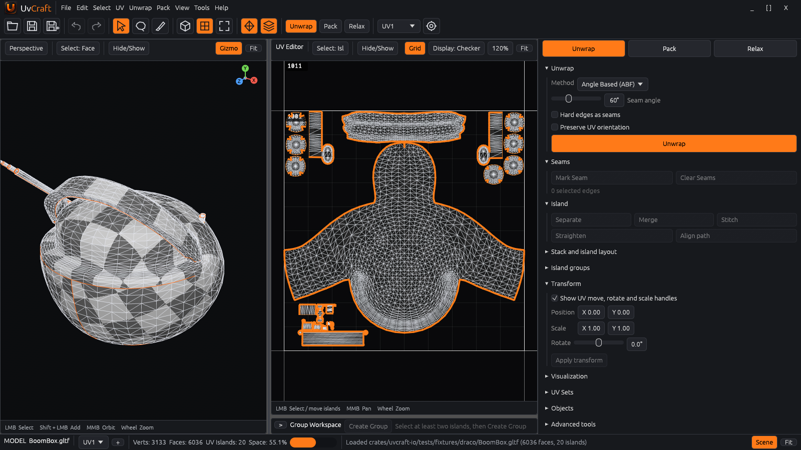

<p align="center">
  
</p>

<h1 align="center">UvCraft</h1>

<p align="center"><strong>Cut seams. Shape islands. Bring your UVs back to Blender.</strong></p>

<p align="center">
  An open source desktop UV editor for artists who want direct control over unwrapping, layout, and distortion.
</p>

<p align="center">
  <a href="https://github.com/RafaelMendes1407/UvCraft/releases/latest"><strong>Download for Linux or Windows</strong></a>
  · <a href="docs/user-guide.md">User guide</a>
  · <a href="bridges/blender/README.md">Blender add-on</a>
</p>

<p align="center">
  <a href="https://github.com/RafaelMendes1407/UvCraft/actions/workflows/release.yml"></a>
</p>



<p align="center"><sub>UvCraft desktop editor with a packed UV layout. This is a screenshot of the application using the BoomBox sample mesh.</sub></p>

## A complete UV workflow in one place

| Create and edit | Organize and pack | Inspect and refine |
| --- | --- | --- |
| Mark seams by hand or generate them from edge angles. Unwrap with **ABF** or **LSCM**, then relax with **SLIM** or **ARAP**. | Move, rotate, scale, group, and stack islands. Pack while keeping groups together and preserving intentional stacks. | Switch between checker, texture, island, distortion, flipped UV, overlap, and texel density displays. Inspect the same distortion analysis in 2D and optionally in 3D. |

UvCraft edits UV coordinates and seams while keeping the original 3D mesh geometry intact. Undo and redo are available throughout the editing session.

### From imported UVs to a packed layout

The same mesh before packing, shown in the live 3D and UV viewports:



<p align="center"><sub>Real application screenshot. BoomBox sample model from the <a href="crates/uvcraft-io/tests/fixtures/draco/README.md">Khronos glTF sample collection</a>.</sub></p>

## Blender → UvCraft → Blender

The bundled add-on connects Blender to the running desktop app over a local bridge. Transfers are deliberate: you choose when to send a mesh and when to receive its edited UVs.

1. In UvCraft, choose **File → Install Blender add-on…**, select your Blender profile, then restart Blender and enable **UvCraft UV Bridge**.
2. In UvCraft, choose **File → Copy bridge token**. In Blender's **3D View → Sidebar (`N`) → UvCraft**, paste it into **Session token** and click **Connect**.
3. Select a mesh in Blender and click **Send Selected**. It opens automatically in UvCraft.
4. Cut seams, unwrap, edit, and pack in UvCraft.
5. Select the same object in Blender and click **Receive UVs** to apply the UV coordinates and seams. Save your `.blend` file.

The bridge checks mesh topology before applying UVs. It does not change Blender's 3D vertices or faces. See the [step-by-step user guide](docs/user-guide.md) for every tool and troubleshooting advice.

## Get UvCraft

Download the latest x86-64 packages from [GitHub Releases](https://github.com/RafaelMendes1407/UvCraft/releases/latest):

| Platform | Start the app |
| --- | --- |
| **Linux** | Extract the `.tar.gz` file and run `./uvcraft-app`. To add a per-user desktop launcher, run `sh packaging/linux/install.sh ./uvcraft-app` inside the extracted directory. |
| **Windows** | Extract the `.zip` file and run `uvcraft-app.exe`. |

The packages include the Blender add-on source. The app can install it through **File → Install Blender add-on…**.

### Build from source

Rust **1.95 or newer** is required. From the repository root:

```sh
cargo run -p uvcraft-app
```

Open an OBJ, glTF, or GLB file from **File → Open…**, drag it onto the window, or pass it at startup:

```sh
cargo run -p uvcraft-app -- path/to/mesh.obj
```

For analysis and command scripts:

```sh
cargo run -p uvcraft-cli -- analyze path/to/mesh.obj --resolution 2048
cargo run -p uvcraft-cli -- run commands.jsonl
```

## Explore the project

- [User guide](docs/user-guide.md) — the full desktop and Blender workflow.
- [Blender add-on guide](bridges/blender/README.md) — installation, connection, and mesh transfer.
- [UV Island Groups](docs/group-workspace.md) — group selection, transforms, and packing.
- [Feature tracker](FEATURES.md) — implemented features and planned work.

The desktop app is in `crates/uvcraft-app`; UV algorithms, commands, and mesh I/O live in `crates/uvcraft-algo`, `crates/uvcraft-commands`, and `crates/uvcraft-io`. The Blender add-on is in `bridges/blender`.

**License:** MIT or Apache-2.0.
